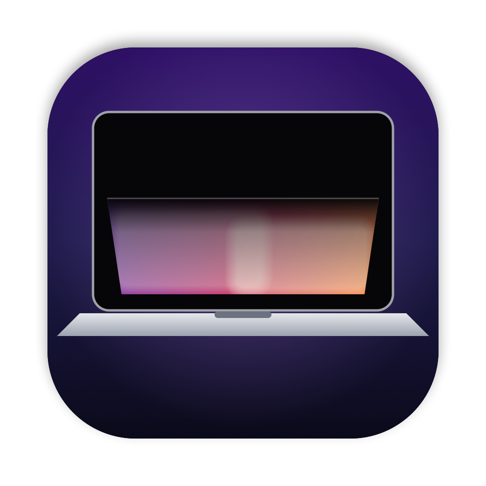
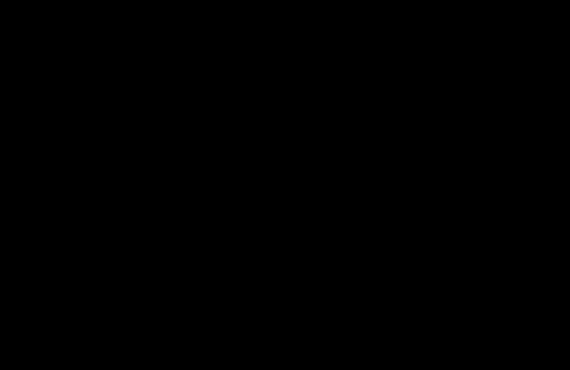
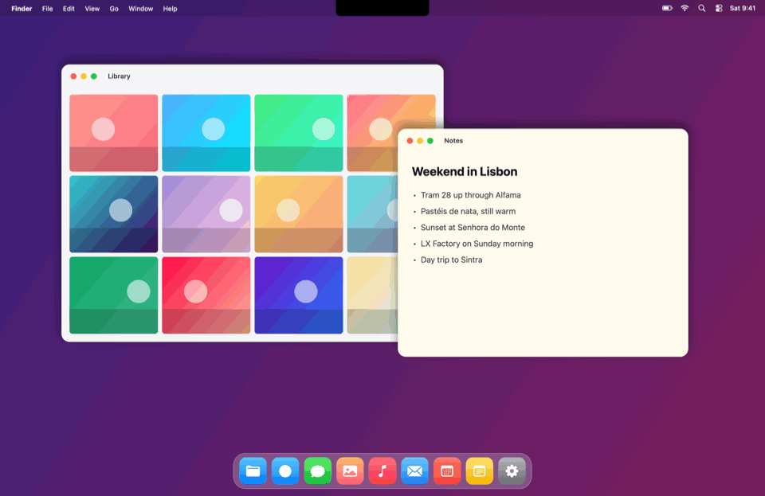
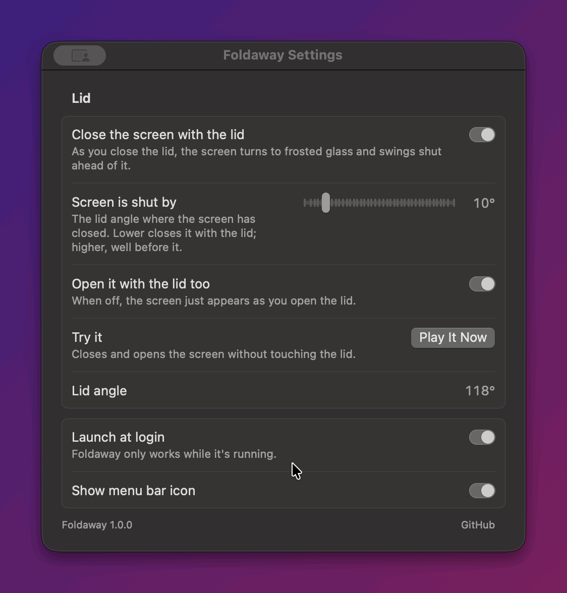

<p align="center">
  
</p>

<h1 align="center">Foldaway</h1>

<p align="center">
  Your MacBook's screen closes before the lid does, like the iPhone Duo's.<br>
  Free, open source, and light on battery.
</p>

<p align="center">
  
</p>

<p align="center">
  <a href="https://github.com/doom1337hvh/Foldaway/releases/latest"><b>Download</b></a> ·
  <a href="#install">Install</a> ·
  <a href="#in-action">In action</a> ·
  <a href="#settings">Settings</a>
</p>

Foldaway follows your MacBook's lid as you close it. The moment the lid starts to move, the screen closes ahead of the lid itself, so it looks closed before the lid is. By default it turns into a pane of frosted glass that swings shut on the hinge: it blurs from the top down, tips toward the keyboard and slips into black. Four more styles fold it, draw it into the notch, lock it, or switch it off like an old TV. Open the lid and it opens again with it. Inspired by the iPhone Duo's fold animation.

## Features

- **Five styles:** Frosted glass, Into the notch, Fold, Lock screen and TV off. See [In action](#in-action).
- **Follows the real lid:** Foldaway reads the MacBook's lid angle sensor to a hundredth of a degree, so the screen closes exactly as fast as your hand moves, and stops when it stops.
- **Frosted glass:** the blur grows from the hinge to the top edge, with a frosted haze and a soft band of light sliding down the glass. The area near the hinge stays sharp longest. The glass tips toward you in real perspective, as seen from about where you sit, and has the same notch and rounded corners as your screen.
- **Closes before the lid:** the screen is dark by 10°, before the lid shuts. Choose the angle yourself, from 5° to 45°.
- **Opens with the lid too**, or the screen can simply appear as you open it.
- **Smooth from end to end:** the effect fades in as the lid starts moving and fades out once it's open, and never jumps to or from black.
- **A live pointer:** the pointer keeps following your mouse while the screen closes, and goes along with it: it tips with the glass, folds with the fold, shrinks into the notch.
- **Change your mind:** stop partway, for example to tilt the screen to a new angle, and the screen opens back up by itself.
- **Respects Reduce Motion:** with it on, the screen just dims as the lid closes.
- **Play It Now** shows the effect without touching the lid.
- **Built for battery life:** no Dock icon, nothing running but a quick look at the lid angle, and the app is about 1 MB. See [Battery](#battery).

Everything above can be switched off or changed in Settings.

## In action

Click one to watch it.

<details>
<summary><b>Into the notch</b>: the screen draws itself up into the camera notch, narrowing to a pill as it goes, like the Dynamic Island closing.</summary>
<p align="center"></p>
</details>

<details>
<summary><b>Fold</b>: a crease down the middle, and the halves fold toward each other, like the iPhone Duo.</summary>
<p align="center"></p>
</details>

<details>
<summary><b>Lock screen</b>: the screen softens into your wallpaper with a big clock, like a phone locking, then goes dark.</summary>
<p align="center"></p>
</details>

<details>
<summary><b>TV off</b>: the picture squashes to a glowing line, shrinks to a dot and fades, like an old television.</summary>
<p align="center"></p>
</details>

<details>
<summary><b>Closing</b> (Frosted glass, slowly): the screen frosts over from the top, tips toward the keyboard and slips into black, ahead of the lid.</summary>
<p align="center"></p>
</details>

<details>
<summary><b>Opening</b> (Frosted glass): the glass rises out of the black with the lid and clears.</summary>
<p align="center"></p>
</details>

<details>
<summary><b>Stopping partway</b>: tilt the screen to a new angle and the glass swings back open by itself.</summary>
<p align="center"></p>
</details>

## Requirements

- A Mac with Apple silicon, running macOS 14 Sonoma or later (developed and tested on macOS 27)
- A MacBook with a lid angle sensor. Most recent MacBooks have one; some older models don't. Foldaway says so in Settings if yours doesn't, and you can check in Terminal: `hidutil list | grep -w las` prints a line if there is one.

## Install

1. Download `Foldaway-<version>.dmg` (or the `.zip`) from the [latest release](https://github.com/doom1337hvh/Foldaway/releases/latest).
2. Drag **Foldaway** into your **Applications** folder. Don't run it from Downloads: macOS runs apps opened there from a temporary copy, and the permission you give that copy doesn't stick.
3. Open Foldaway. macOS will say *"Apple could not verify 'Foldaway' is free of malware"*. Click **Done**.
4. Open **System Settings → Privacy & Security**, scroll down to **Security**, and click **Open Anyway** next to *"Foldaway was blocked"*. Confirm with **Open Anyway** and your password or Touch ID.
5. Foldaway opens its Settings. Click **Allow…** next to Screen Recording and turn Foldaway on (see [Permissions](#permissions)).
6. A laptop appears in the menu bar. Close your lid.

**Why the warning?** Apple only vouches for ("notarizes") apps whose developers pay for an Apple Developer account. Foldaway is a free project and isn't notarized. The source code is all here, and you can [build it yourself](#build-from-source) instead.

**Prefer Terminal?** Instead of steps 3 and 4, run this, then open the app normally:

```bash
xattr -dr com.apple.quarantine /Applications/Foldaway.app
```

**Check your download (optional):** each release lists SHA-256 checksums in `SHA256SUMS.txt`. Compare them with:

```bash
shasum -a 256 ~/Downloads/Foldaway-*.dmg
```

## Updating

Quit Foldaway (menu bar laptop → Quit), replace the app in Applications with the new one, and open it. Each new download needs **Open Anyway** once more. Screen Recording stays allowed, because every release is signed with the same certificate. If a release ever can't be, its notes will say so, and you'll need to allow it again.

## Permissions

| Permission | Asked when | What it's for |
|---|---|---|
| **Screen Recording** | You first open Foldaway | Taking one picture of your screen as the lid starts to close, to animate. It's kept in memory only while the effect is on screen, and never saved. |
| **Login Items** | You turn on **Launch at login** | Starting Foldaway when you log in. |

Reading the lid angle sensor needs no permission. After allowing Screen Recording, macOS may ask you to quit and reopen Foldaway, and it may occasionally ask you to confirm that Foldaway can still record the screen.

**Privacy:** Foldaway never connects to the internet. It has no analytics, no accounts and no update checks. The picture of your screen and your settings stay on your Mac.

## Settings

Open Settings from the laptop in the menu bar, or by opening Foldaway again while it's running (useful if you've hidden the menu bar icon).

<details>
<summary><b>See the Settings window</b></summary>
<p align="center"></p>
</details>

**Lid**
- **Close the screen with the lid** (on by default): the main switch, also in the menu bar menu.
- **Style:** Frosted glass (default), Into the notch, Fold, Lock screen or TV off. Also in the menu bar menu.
- **Screen is shut by** (10° by default): the lid angle where the screen has closed. Lower closes it together with the lid; higher closes it well before.
- **Open it with the lid too** (on by default): opening the lid plays the effect in reverse. When off, the screen just appears.
- **Try it → Play It Now:** closes and opens the screen without touching the lid. Also in the menu bar menu.
- **Lid angle:** what the sensor reads right now.

**General:** launch at login, and the menu bar icon.

## Battery

Measured on an M5 MacBook Pro on battery, with Foldaway idle:

| | Foldaway | CPU | Energy impact |
|---|---|---|---|
| Waiting for the lid | 8 MB | 0.3–0.4% | 0.3–0.7 |

The only ongoing cost is reading the lid angle ten times a second, which is how quickly Foldaway notices the lid starting to move. Each reading takes under a millisecond.

The rest costs nothing while idle:
- The picture of the screen is only taken once the lid starts to close, and dropped as soon as it's open again.
- The effect is only drawn, and the sensor only read every frame, while the lid is moving.
- The blurred copies of the screen are made at a fraction of its size: a blurred picture needs few pixels.

## Troubleshooting

- **Nothing happens when I close the lid:** check that Screen Recording is allowed (the menu bar menu warns if it isn't), that **Close the screen with the lid** is on, and that **Lid angle** in Settings shows a number that changes as you move the lid. Foldaway only works while it's running; turn on **Launch at login**.
- **Foldaway is switched on under Screen Recording, but still says it isn't allowed:** macOS may still have an older copy of Foldaway on record. In **System Settings → Privacy & Security → Screen & System Audio Recording**, select Foldaway, remove it with **−**, then click **Allow…** in Foldaway's Settings again.
- **Check what macOS reports:** this prints whether Screen Recording is allowed, and the lid angle:

  ```bash
  open -n -W --stdout /dev/stdout /Applications/Foldaway.app --args --check
  ```

- **Two pointers while the screen closes:** Foldaway hides the real pointer and draws its own on the closing screen, through a private macOS setting (see below), which a macOS update may have changed. Everything else still works.
- **Lock screen shows your blurred screen rather than your wallpaper:** a dynamic or video wallpaper isn't a still picture Foldaway can read, so it blurs the screen instead.

## Unofficial APIs

The lid angle sensor isn't documented by Apple: Foldaway reads it as an HID sensor (usage page 0x20, usage 0x8A), the same way other open-source lid-angle apps do. To hide the real pointer while it draws its own, without coming to the front, it also sets a private WindowServer option.

None of this is supported by Apple. A macOS update could break Foldaway at any time, and there may be no fix. Foldaway is an independent project, not affiliated with or endorsed by Apple.

## Uninstall

Quit Foldaway (menu bar laptop → Quit), delete it from Applications, and optionally remove its settings:

```bash
defaults delete io.github.doom1337hvh.Foldaway
```

You can also remove it from the lists in **System Settings → Privacy & Security**.

## Build from source

You need the Xcode Command Line Tools (`xcode-select --install`); Xcode itself isn't needed.

```bash
git clone https://github.com/doom1337hvh/Foldaway.git
```

```bash
cd Foldaway && scripts/build.sh
```

The app is built to `build/Foldaway.app`. `scripts/build.sh --install` also copies it to `~/Applications` and opens it there.

Optionally, run `scripts/create-signing-cert.sh` once first. It makes a local code-signing certificate, so the permission you grant survives rebuilds; otherwise each build is signed ad hoc and macOS treats it as a new app. To make a release, see [docs/RELEASING.md](docs/RELEASING.md).

The clips above are recorded from the real app, closing a make-believe lid over a made-up desktop. After a build, `swift scripts/make-video.swift` records them all again into `docs/demo.gif` and `docs/clips` (plus `docs/demo.mp4` for sharing); name scenes to record just those. It needs the Screen Recording permission and a MacBook.

### How it works

- **Watching the lid:** `LidSensor` reads the angle from the sensor's HID feature report, ten times a second while idle. A drop of a degree or two gets the picture of the screen ready; falling faster than 15° a second counts as closing.
- **Following it:** from then on, `LidWatcher` reads the sensor up to 60 times a second. The sensor only updates about ten times a second, so between updates it predicts where the lid has got to from how fast it's moving, and a critically damped spring smooths the result.
- **The picture:** `ScreenSnapshot` takes it with ScreenCaptureKit, and `Frost` adds the screen's notch and rounded corners and makes four ever more blurred copies with Core Image (and, for Lock screen, a blurred copy of the wallpaper).
- **The styles:** `LidOverlay` puts a window above everything else, with a live pointer, and one of the styles in `LidStyles.swift` draws in it with Core Animation, given how far the lid has closed. Frosted glass stacks the blurred copies on a pane hinged at the bottom of the screen, each masked by a gradient so the blur grows from the hinge up, and tips the pane in 3D under perspective; the others crop, fold, crossfade and squash the same picture.

The app itself is SwiftUI in an AppKit shell:

```
Sources/Foldaway/
  AppDelegate.swift, main.swift   app lifecycle, menu bar icon and menu
  LidSensor.swift                 the lid angle sensor
  LidWatcher.swift                noticing the lid closing, following it, the make-believe lid
  ScreenSnapshot.swift, Frost.swift   the picture of the screen, and its blurred copies
  LidOverlay.swift                the window over the screen, the live pointer, fading
  LidStyles.swift                 Frosted glass, Into the notch, Fold, Lock screen, TV off
  Pointer.swift                   hiding the real pointer while the effect is up
  DemoScene.swift                 the made-up desktop and scripted scenes for the README's clips
  Preferences.swift, Permissions.swift, SettingsView.swift
scripts/                          build, release, signing certificate, icon, README clips
```

## License

Foldaway is released under the [MIT License](LICENSE).
